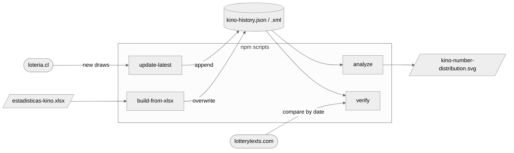

# Kino2026

Keeps a history of Chilean Kino draws and charts how often each number comes up.

- `kino-history.json` / `kino-history.xml` — every draw, keyed by the official
  draw ("sorteo") number.
- `stats/estadisticas-kino.xlsx` — the workbook the history was first built from.
- `stats/kino-number-distribution.svg` — the frequency chart.

## Data flow



## Scripts

| Command | What it does |
| --- | --- |
| `npm run update-latest` | Adds every draw the history is missing from loteria.cl. |
| `npm run analyze` | Regenerates the frequency chart from `kino-history.json`. |
| `npm run verify` | Compares the history with lotterytexts.com by date. Read-only. |
| `npm run build-from-xlsx` | Rebuilds the whole history from the workbook. |
| `npm test` | Type-checks the project. |

`update-latest` recovers skipped runs on its own, but only as far back as the
results page lists (the last 26 draws, about two months). If the gap is older,
the run fails and names the missing draws; add them to the workbook and run
`build-from-xlsx`.

`build-from-xlsx` overwrites the history with the workbook's contents. Only run
it after updating the workbook, or draws newer than the workbook are dropped.

## Running locally

```sh
npm ci
npx playwright install chromium
npm run update-latest
```

On Windows, `run-update.ps1` runs the update and appends the output to
`update-latest.log`. To schedule it, run `register-update-task.ps1` once from an
elevated PowerShell: it registers a task that runs the update on Monday,
Thursday and Saturday at 10:00, whether or not anyone is logged on.

## Docker

The image is a one-shot job, not a web server. It uses Playwright to fetch new
draws and updates `kino-history.json` and `kino-history.xml` on the host.

Build the image and run an update:

```sh
docker compose build
docker compose run --rm kino-update
```

Run the same command from a host scheduler (such as cron or Windows Task
Scheduler) to update the history periodically. Compose mounts both history
files and the `stats` folder from the project directory, so whatever a script
writes persists between runs.

To run another script in the container, override the command:

```sh
docker compose run --rm kino-update npm run analyze
docker compose run --rm kino-update npm run verify
docker compose run --rm kino-update npm run build-from-xlsx
```

Rebuild the image after changing anything under `src`.
