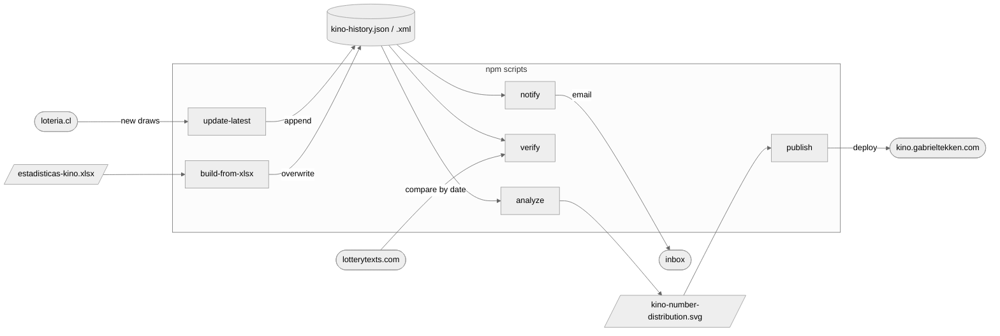

# Kino2026

Keeps a history of Chilean Kino draws and charts how often each number comes up.

- `kino-history.json` / `kino-history.xml` — every draw, keyed by the official
  draw ("sorteo") number.
- `stats/estadisticas-kino.xlsx` — the workbook the history was first built from.
- `stats/kino-number-distribution.svg` — the frequency chart.

## Data flow



## Scripts

| Command | What it does |
| --- | --- |
| `npm run update-latest` | Adds every draw the history is missing from loteria.cl, then runs `analyze`. |
| `npm run analyze` | Regenerates the frequency chart from `kino-history.json`. |
| `npm run verify` | Compares the history with lotterytexts.com by date. Read-only. |
| `npm run build-from-xlsx` | Rebuilds the whole history from the workbook. |
| `npm run publish` | Builds the web page and deploys it to Cloudflare Pages if the chart changed (`-- --force` deploys anyway, `-- --build-only` only builds `dist/site`). |
| `npm run notify` | Emails (and posts to Discord) how many numbers of each new draw were among the 14 most and 14 least frequent (`-- --preview` prints the email instead, `-- --draw N` reports on draw N). |
| `npm run backtest` | One-time back analysis: for every draw from #1, the matches with the 14 most and 14 least frequent numbers before it, and how many draws had each match count against chance. Writes `stats/kino-backtest.json`, two charts (`kino-backtest.svg` for matches over time, `kino-backtest-distribution.svg` for the match counts) and a PNG of each. Needs the Playwright browser, like `update-latest`. |
| `npm test` | Type-checks the project. |

`update-latest` recovers skipped runs on its own, but only as far back as the
results page lists (the last 26 draws, about two months). If the gap is older,
the run fails and names the missing draws; add them to the workbook and run
`build-from-xlsx`.

`build-from-xlsx` overwrites the history with the workbook's contents. Only run
it after updating the workbook, or draws newer than the workbook are dropped.

## Running locally

```sh
npm ci
npx playwright install chromium
npm run update-latest
```

On Windows, `run-update.ps1` runs the update, redraws the chart, publishes the
web page, sends the email (both once `.env` exists, see below) and appends the
output to `update-latest.log`. To schedule it, run `register-update-task.ps1` once from an
elevated PowerShell: it registers a task that runs the update on Monday,
Thursday and Saturday at 10:00, whether or not anyone is logged on.

## Web page

`npm run publish` puts the chart on a Cloudflare Pages site
(<https://kino.gabrieltekken.com>). It builds `dist/site` from
`site/index.html` with the chart inlined, and uploads it with wrangler. One-time
setup, on the machine that runs the scheduled update:

1. Copy `.env.example` to `.env` and fill in `CLOUDFLARE_API_TOKEN` and
   `CLOUDFLARE_ACCOUNT_ID`. The token needs **Account › Cloudflare Pages ›
   Edit**; the one used by another Pages project on the same account works.
2. Create the Pages project once:

   ```sh
   npx wrangler pages project create kino --production-branch main
   ```

3. Run `npm run publish`. It prints `Site deployed.` and the page is live at the
   `pages.dev` address wrangler shows.
4. In the Cloudflare dashboard, under **Workers & Pages › kino › Custom
   domains**, add `kino.gabrieltekken.com`.

`.env` is git-ignored and must never be committed.

## Email and Discord

After each new draw, `npm run notify` emails how many of the drawn numbers were
among the 14 most frequent and the 14 least frequent. Both groups are ranked on
the draws before that one, so the draw does not count towards its own ranking.
If a run adds several draws, they go in one email.

It sends through Gmail. In your Google account, create an app password
(**Security › 2-Step Verification › App passwords**), then put your address in
`.env` as `GMAIL_USER` and the app password as `GMAIL_APP_PASSWORD`. The email
goes to `GMAIL_USER` unless `NOTIFY_TO` names another address. Without these
values the script says so and sends nothing.

The first run emails the latest draw. To see the email without sending it:

```sh
npm run notify -- --preview
```

### Discord

If `.env` has `DISCORD_WEBHOOK_URL`, the same report is also posted to that
channel, styled like the GT Terminal server kit: an amber accent bar, uppercase
labels, a monospace table, and green / red (with an arrow) for matches above or
below what chance gives. Create the webhook under **Server Settings ›
Integrations › Webhooks**. `DISCORD_AVATAR_URL` optionally sets the picture
shown next to the name. The server icon and banner themselves are uploaded by
hand under **Server Settings › Overview**; a script cannot set them.

Every Discord message also carries the back-analysis charts from `stats/`: the two PNGs show full width under the report (SVG files are not sent, since Discord shows them as code). Regenerate them with `npm run backtest`; files that do not exist are skipped.

The email and the Discord message are each sent only if their values are in
`.env`. A run is recorded as done only after every configured channel
succeeded, so a failed one is retried (and the other channel may repeat).
