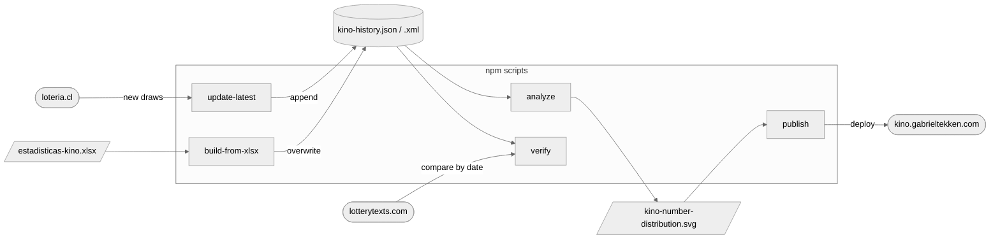

# Kino2026

Keeps a history of Chilean Kino draws and charts how often each number comes up.

- `kino-history.json` / `kino-history.xml` — every draw, keyed by the official
  draw ("sorteo") number.
- `stats/estadisticas-kino.xlsx` — the workbook the history was first built from.
- `stats/kino-number-distribution.svg` — the frequency chart.

## Data flow



## Scripts

| Command | What it does |
| --- | --- |
| `npm run update-latest` | Adds every draw the history is missing from loteria.cl, then runs `analyze`. |
| `npm run analyze` | Regenerates the frequency chart from `kino-history.json`. |
| `npm run verify` | Compares the history with lotterytexts.com by date. Read-only. |
| `npm run build-from-xlsx` | Rebuilds the whole history from the workbook. |
| `npm run publish` | Builds the web page and deploys it to Cloudflare Pages if the chart changed (`-- --force` deploys anyway, `-- --build-only` only builds `dist/site`). |
| `npm test` | Type-checks the project. |

`update-latest` recovers skipped runs on its own, but only as far back as the
results page lists (the last 26 draws, about two months). If the gap is older,
the run fails and names the missing draws; add them to the workbook and run
`build-from-xlsx`.

`build-from-xlsx` overwrites the history with the workbook's contents. Only run
it after updating the workbook, or draws newer than the workbook are dropped.

## Running locally

```sh
npm ci
npx playwright install chromium
npm run update-latest
```

On Windows, `run-update.ps1` runs the update, redraws the chart, publishes the
web page (once `.env` exists, see below) and appends the output to
`update-latest.log`. To schedule it, run `register-update-task.ps1` once from an
elevated PowerShell: it registers a task that runs the update on Monday,
Thursday and Saturday at 10:00, whether or not anyone is logged on.

## Web page

`npm run publish` puts the chart on a Cloudflare Pages site
(<https://kino.gabrieltekken.com>). It builds `dist/site` from
`site/index.html` with the chart inlined, and uploads it with wrangler. One-time
setup, on the machine that runs the scheduled update:

1. Copy `.env.example` to `.env` and fill in `CLOUDFLARE_API_TOKEN` and
   `CLOUDFLARE_ACCOUNT_ID`. The token needs **Account › Cloudflare Pages ›
   Edit**; the one used by another Pages project on the same account works.
2. Create the Pages project once:

   ```sh
   npx wrangler pages project create kino --production-branch main
   ```

3. Run `npm run publish`. It prints `Site deployed.` and the page is live at the
   `pages.dev` address wrangler shows.
4. In the Cloudflare dashboard, under **Workers & Pages › kino › Custom
   domains**, add `kino.gabrieltekken.com`.

`.env` is git-ignored and must never be committed.
